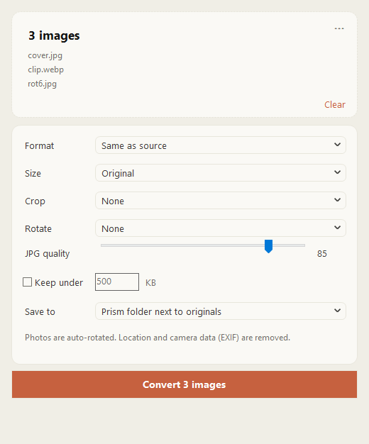
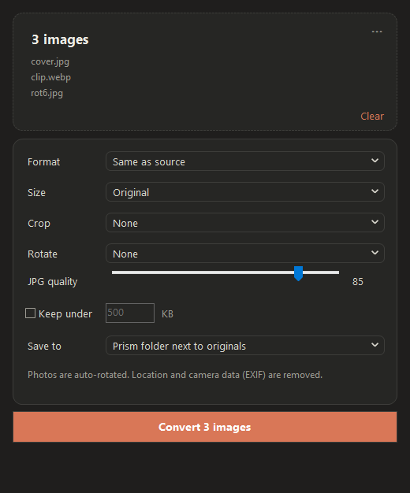

<p align="center"></p>

# Prism

**Drop images, pick a preset, convert the whole batch. Your originals stay untouched.**

Prism is a small batch image converter for Windows. It reads JPG, PNG, BMP, GIF and TIFF, plus WebP and HEIC when the Windows codec is installed. It writes JPG, PNG, BMP, GIF, TIFF or one PDF. Photos are auto-rotated from EXIF and all metadata, including GPS location, is removed. The whole app is a ~70 KB `.exe`.

| Light | Dark |
|---|---|
|  |  |

## Features

- **Batch in, batch out**: drop files or whole folders, paste a screenshot with `Ctrl+V`, then convert all of them in one click.
- **Resize**: percent (75, 50, 25), long edge presets (3840, 2048, 1080, 720 px) or a custom size in pixels. Images are never upscaled.
- **Crop for social posts**: center crop to 1:1, 4:5, 16:9 or 9:16, then rotate or mirror.
- **Fit upload limits**: "Keep under N KB" finds the best JPG quality for the limit and shrinks the image only when it must.
- **Clean photos**: EXIF orientation is applied so phone photos come out upright, then every tag is dropped.
- **One PDF**: many images go into a single PDF, one page per image.
- **Originals are never touched**: results go to a "Prism" folder next to the sources, or a folder you pick. Existing files are never overwritten.
- **Send to menu**: add Prism to the Windows "Send to" menu from the "..." button.
- **Remembers your settings** between runs. Light or dark theme and English or Turkish UI follow Windows.
- **Not running in the background**: open, convert, close. Images only, no video or audio.

## Download

1. Grab `Prism.exe` from the [latest release](../../releases/latest) and put it anywhere.
2. Run it, drop your images and press Convert.
3. Optional: "..." button -> *Add to Send To menu*.

> Windows SmartScreen may warn about an unknown publisher (the exe isn't code-signed). Click *More info -> Run anyway*, or build it yourself (below).

## Build from source

No SDK needed; the C# compiler that ships with Windows is enough:

```powershell
git clone https://github.com/nihat3371/prism
cd prism
.\build.ps1
```

## Family

Small, fast, calm Windows tools: [Mote](https://github.com/nihat3371/mote) (Markdown reader) · [Glint](https://github.com/nihat3371/glint) (ask Claude about your screen) · Prism.

## License

[MIT](LICENSE)
